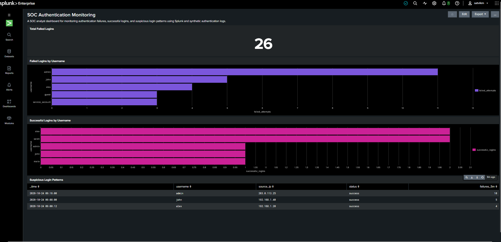
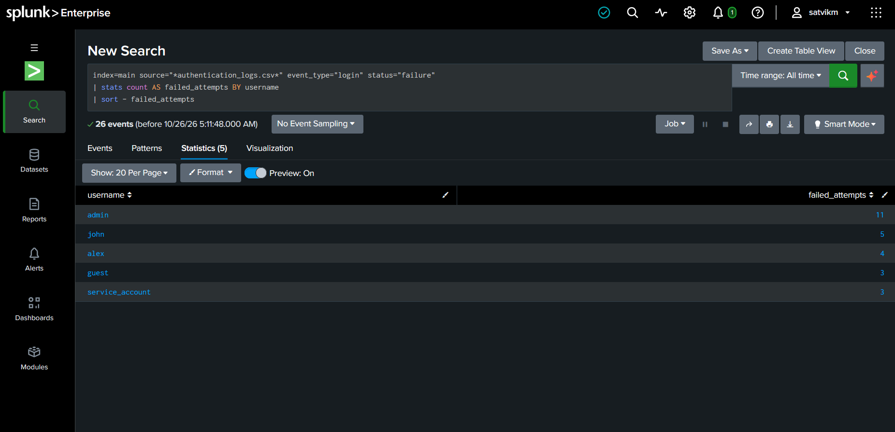
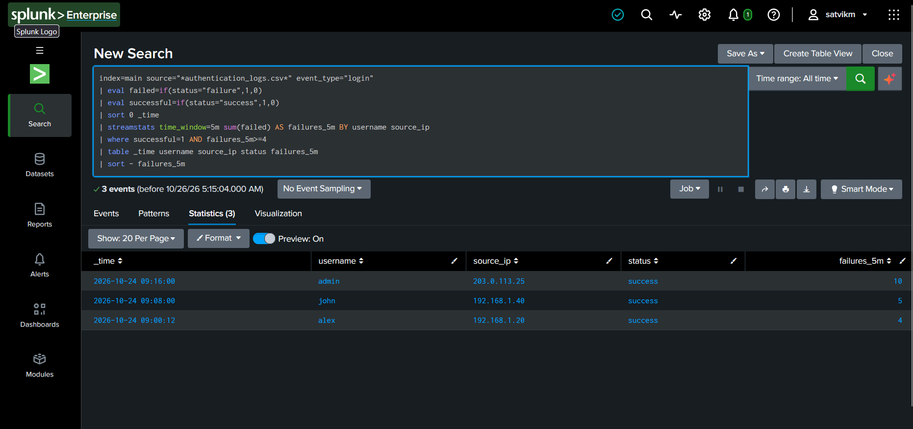

# Splunk SOC Authentication Monitoring Lab

A hands-on Security Operations Center (SOC) project using Splunk Enterprise to analyze authentication logs, detect suspicious login activity, investigate potential security incidents, and document findings.

**Project Status:** Core searches, dashboard panels, incident investigation, and documentation are complete. The detections use synthetic authentication data and have not been validated in a production environment.

## Project Overview

This project simulates a basic SOC investigation workflow using synthetic authentication logs ingested into Splunk Enterprise.

The objective is to practice foundational SOC Analyst Level 1 skills, including log analysis, detection engineering, security monitoring, investigation, and incident documentation.

The lab focuses on identifying repeated failed login attempts and successful logins following multiple failures within a rolling five-minute window.

## Objectives

* Ingest and search authentication logs using Splunk Enterprise.
* Analyze successful and failed login events.
* Write SPL queries to identify suspicious authentication patterns.
* Investigate repeated failed logins and subsequent successful logins.
* Build a dashboard to visualize authentication activity.
* Document investigation findings and incident severity.
* Maintain a structured cybersecurity project portfolio on GitHub.

## Tools and Technologies

| Tool                             | Purpose                                                    |
| -------------------------------- | ---------------------------------------------------------- |
| Splunk Enterprise                | Log ingestion, searching, analysis, and dashboard creation |
| Search Processing Language (SPL) | Authentication detection queries                           |
| CSV                              | Synthetic authentication dataset                           |
| GitHub                           | Version control and project documentation                  |
| Markdown                         | Incident reports and investigation findings                |

## Repository Structure

```text
splunk-soc-authentication-lab/
├── README.md
├── data/
│   ├── README.md
│   └── authentication_logs.csv
├── detections/
│   ├── README.md
│   ├── failed-login-threshold.spl
│   └── successful-login-after-failures.spl
├── incident-reports/
│   └── incident-report-admin-authentication.md
├── screenshots/
│   ├── dashboard-overview.png
│   ├── failed-logins-by-user.png
│   └── suspicious-login-patterns.png
└── documentation/
    └── investigation-findings.md
```

## Dataset

The lab uses a synthetic CSV dataset containing 36 authentication-related events.

### Dataset Fields

| Field        | Description                               |
| ------------ | ----------------------------------------- |
| `timestamp`  | Time of the recorded event                |
| `username`   | Account associated with the event         |
| `source_ip`  | Source IP address recorded in the event   |
| `event_type` | Event category, such as login or logout   |
| `status`     | Event outcome, such as success or failure |
| `host`       | Host associated with the event            |

### Initial Observations

| Metric                  | Observed Count |
| ----------------------- | -------------: |
| Total events            |             36 |
| Failed events           |             26 |
| Successful events       |             10 |
| Successful login events |              7 |

The successful-event count includes successful logout events. Therefore, the total number of successful events is not the same as the number of successful logins.

The dataset is synthetic and is intended for educational investigation, not for measuring real-world attack activity.

## Lab Setup

1. Install and launch Splunk Enterprise.
2. Open Splunk Web at `http://localhost:8000`.
3. Import `data/authentication_logs.csv` into Splunk.
4. Select the `main` index for the dataset.
5. Confirm that the authentication events are searchable.
6. Run the SPL detections in the `detections/` directory.
7. Review the dashboard and investigate the resulting events.
8. Document findings and limitations.

**Note:** The dashboard and searches in this project were developed against the synthetic dataset. Field extraction, timestamp recognition, and source filtering should be verified when reproducing the lab in another Splunk environment.

## Detection Rules

### 1. Repeated Failed Login Attempts

**File:** `detections/failed-login-threshold.spl`

**Objective:** Identify username and source IP combinations with three or more failed login events.

#### SPL Query

```spl
index=main source="*authentication_logs.csv*" event_type="login" status="failure"
| stats count AS failed_attempts BY username source_ip
| where failed_attempts >= 3
| sort - failed_attempts
```

#### Observed Results

| Username        | Failed Login Attempts |
| --------------- | --------------------: |
| admin           |                    11 |
| john            |                     5 |
| alex            |                     4 |
| guest           |                     3 |
| service_account |                     3 |

#### Interpretation

The query identifies accounts with repeated failed login attempts. These patterns may indicate repeated authentication errors or suspicious activity and should be investigated in context.

A threshold match alone does not establish malicious activity or account compromise.

### 2. Successful Login After Repeated Failures

**File:** `detections/successful-login-after-failures.spl`

**Objective:** Identify successful login events associated with at least four failures in a rolling five-minute window for the same username and source IP address.

#### SPL Query

```spl
index=main source="*authentication_logs.csv*" event_type="login"
| eval failed=if(status="failure",1,0)
| eval successful=if(status="success",1,0)
| sort 0 _time
| streamstats time_window=5m sum(failed) AS failures_5m BY username source_ip
| where successful=1 AND failures_5m>=4
| table _time username source_ip status failures_5m
| sort - failures_5m
```

#### Observed Results

| Username | Successful Login | Failures in the Applicable Window |
| -------- | ---------------- | --------------------------------: |
| admin    | 09:16:00         |                                10 |
| john     | 09:08:00         |                                 5 |
| alex     | 09:00:12         |                                 4 |

#### Interpretation

These events warrant investigation because successful logins followed multiple failed attempts within the detection window.

The pattern may be consistent with repeated password guessing or other authentication issues. However, the available logs do not prove that an attacker gained access.

The detection counts failures for the same username and source IP address within a rolling time window. Results depend on correctly parsed event timestamps and the available fields.

## Dashboard

The **SOC Authentication Monitoring** dashboard provides a visual overview of authentication activity.

It contains four panels:

1. Total failed login events.
2. Failed login attempts by username.
3. Successful login events by username.
4. A table of suspicious login patterns.

The dashboard helps an analyst identify accounts with repeated failures and review authentication activity that may require further investigation.

### Dashboard Screenshots

#### Dashboard Overview



#### Failed Logins by User



#### Suspicious Login Patterns



## Investigation Findings

The investigation identified a notable authentication sequence involving the `admin` account.

### Admin Authentication Sequence

* Ten consecutive failed login attempts occurred between `09:15:00` and `09:15:45`, at five-second intervals.
* A successful login followed at `09:16:00`.
* Another failed login event was recorded at `09:55:00`.

The close timing between the repeated failures and the subsequent successful login makes the sequence worthy of further investigation.

### Investigation Assessment

**Assessment:** Suspicious authentication activity requiring further investigation.

**Provisional severity:** Medium.

**Confirmed compromise:** Not established.

The severity is a preliminary assessment based on the observed authentication pattern, not a confirmed incident classification.

The dataset does not contain sufficient evidence to determine whether the successful login was legitimate or unauthorized.

See [`documentation/investigation-findings.md`](documentation/investigation-findings.md) for additional findings and [`incident-reports/incident-report-admin-authentication.md`](incident-reports/incident-report-admin-authentication.md) for the incident report.

## Recommended SOC Follow-Up Actions

If this pattern appeared in a real environment, an analyst could:

1. Verify whether the successful login was expected and authorized.
2. Review the account owner's activity and authentication history.
3. Correlate the event with MFA, VPN, endpoint, and identity-provider logs.
4. Check for additional suspicious activity after the successful login.
5. Escalate the case according to organizational incident-response procedures if supporting evidence indicates possible compromise.

These are recommended investigative steps, not actions performed or confirmed by this lab.

## Limitations

* The dataset contains synthetic authentication events, not production telemetry.
* The source IP `203.0.113.25` belongs to a documentation-reserved IP range and must not be treated as evidence of a real attacker.
* The available data does not include MFA outcomes, endpoint telemetry, session activity, or post-authentication behavior.
* A successful login following failed attempts does not independently prove account compromise.
* The detection thresholds are educational examples and may require tuning for a real environment.
* The detections have not been validated against production data or evaluated for false-positive and false-negative rates.

These limitations are important when interpreting results and applying the detections outside this lab.

## Skills Demonstrated

* Splunk Enterprise fundamentals.
* Authentication log analysis.
* Search Processing Language (SPL).
* Repeated failed-login detection.
* Time-window-based authentication correlation.
* Dashboard creation and monitoring.
* Initial incident triage and severity assessment.
* Incident reporting and investigation documentation.
* GitHub project organization and technical documentation.

## Learning Outcomes

This project provided hands-on practice with a basic SOC workflow: ingesting logs, searching events, developing detection queries, reviewing suspicious authentication sequences, visualizing findings, and documenting an investigation.

It also demonstrates the importance of distinguishing suspicious activity from confirmed compromise and documenting the limitations of available evidence.

## Future Improvements

Potential extensions include:

* Testing the detections against additional synthetic authentication scenarios.
* Measuring false positives and refining detection thresholds.
* Adding Windows Security Event logs.
* Correlating authentication events with additional security telemetry.
* Developing additional detections for account lockouts and suspicious account activity.
* Documenting detection test cases and expected results.

## Project Files

* [Synthetic authentication dataset](data/authentication_logs.csv)
* [Detection queries](detections/)
* [Incident report](incident-reports/incident-report-admin-authentication.md)
* [Investigation findings](documentation/investigation-findings.md)
* [Dashboard screenshots](screenshots/)

## Disclaimer

This project is for educational purposes only. All authentication events are synthetic and intended to demonstrate foundational security monitoring and investigation techniques.

The findings do not establish that a real attack occurred or that any account was compromised.

---

**Author:** Satvik Mamgain
**Project:** Splunk SOC Authentication Monitoring Lab
**Repository:** [splunk-soc-authentication-lab](https://github.com/mamgainsatvik7-sketch/splunk-soc-authentication-lab)
